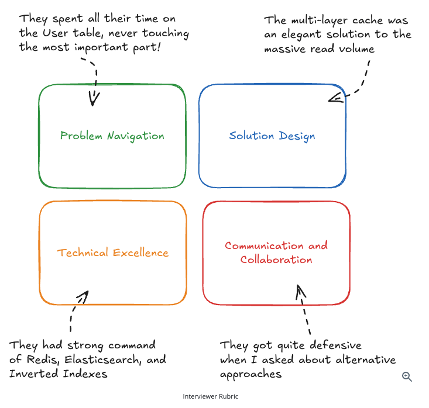
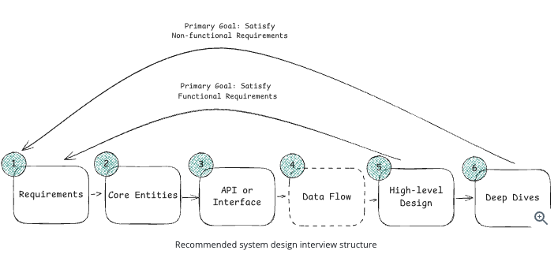
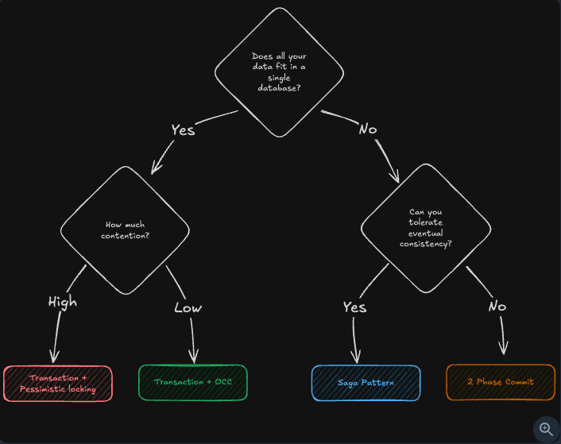

# Assesment areas

# Delivery framework

1. Requirements (Features) (˜5 mins)
   - Functional (`User` should be able to..)
   - Non-functional (`System` should be.. `..ities`, CAP, Latency, Scalable, Reliable)
     - Quantify also: e.g. latecy should be less than 100ms v/s low latency.

2. Core Entities (˜2 mins)
   - These are the core entities that your API will exchange and that your system will persist in a Data Model.
   - Who are the actors in the system? Are they overlapping? What are the nouns or resources necessary to satisfy the functional requirements?

3. API or System interface (˜5 mins)
   - Usually, this maps directly to the functional requirements we've already identified (but not always!). i.e. usually one API for each
     core func requirement.
   - API Protocol choices (always default to REST unless there's a usecase for the other.)
     - REST
     - GraphQL: Allows clients to specify exactly what data they want to receive, avoiding over-fetching and under-fetching. Choose this when you have diverse clients with different data needs.
     - RPC: Action-oriented protocol (like gRPC) that's faster than REST for service-to-service communication. Use for internal APIs when performance is critical.

4. (Optional) Data Flow (˜5 mins)
   - Define high level sequence of action in the system. You'll need it when you need it.

5. High level design (10-15 mins)
   - Primary goal is to design an architecture that satisfies the API we've designed in the prev steps, and thus, the requirements we've identified.
   - Start with simple/straight forward design for each component that satisfies the APIs, even if they seem naive. Complexity can then be layered and will naturally come as we start satisfying the non functional requirements, and can be elaborately tackled in the deep dive section of the interview.

6. ## Deep dive (˜10 mins)
   - Mainly to satisfy the non-fuctional reqs (`..ities`) we had noted down.

# On Contention

- Contention is when multiple DB transactions are wanting to read/update the same resource (think row)
- Solutions:
  - Single DB node:
    1. Pessimistic Locks (Think `FOR UPDATE`):
       a. Assumes that contentions/race will eventually happen, therefore acts in advance.
       b. Suited for high contention scenarios/write heavy systems.
       c. Has a performance implications.

    2. Isolation Levels - how do concurrent txns in a DB interact:
       a. `READ UNCOMMITTED` - Can see uncommitted changes from other transactions (rarely used)
       b. `READ COMMITTED` - Can only see committed changes (default in PostgreSQL)
       c. `REPEATABLE READ` - Same data read multiple times within a transaction stays consistent (default in MySQL)
       d. `SERIALIZABLE` - Strongest isolation, transactions appear to run one after another. Extremely detrimental to performance, especially for high contention scenarios.

    3. Optimistic Concurrency Control (Think `compare-and-swap` pattern):
       a. Optimistically assumes that contentions/race will be rare.
       b. Suited for low contention/read heavy systems.
       c. Low performance implication.

- Multiple DB nodes:
  - The problem gets significantly difficult here. Requires coordination between multiple nodes.
  1. Two-phase Commit (2PC):
     - Coordinatar and nodes. Coordinator issues Prepare and Commit commands.
     - Extremely flaky and under-performant.
     - However, provides strong consistency gurantees. Therefore, keep it as a last resort, but when you need it, then you need it!

  2. Distributed locks (Think `Redis TTL`, `Zookeeeper/etcd`):
     - Top choice when you need application level distributed locking for better UX. Think seat reservation for a small window of time.

# On Scaling Reads

- When a need to scale read arises, follow this (in order):
  - Optimize read performance within your DB (index & denormalization)
  - Scale your DB horizontally (read replicas and/or sharding)
  - Add external caching layers (application and/or CDN)

# On Redis (In-memory datastructure store)

## Popular Usecases

- Cache
- Distributed locks
- Rate limiter
- Stream
- Heap
- Geospatial Indexes
- Pub/Sub
